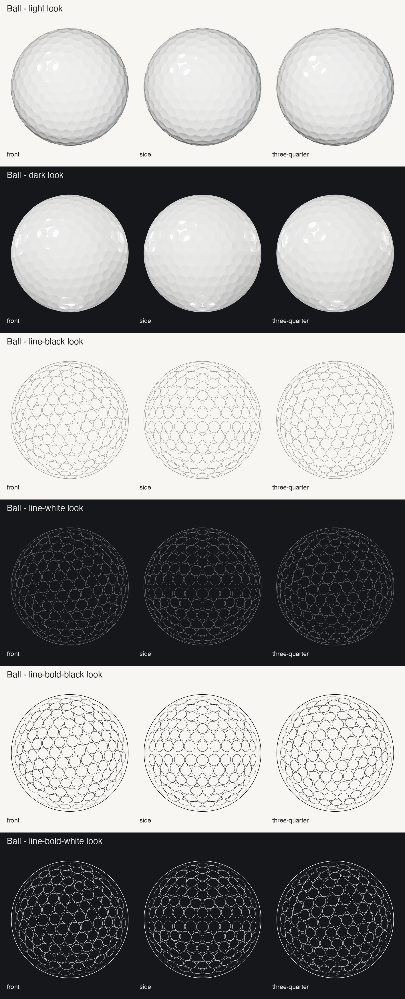

# Golf ball and impact patch

A generic golf ball, modelled from scratch and rendered headless in Blender, and the impact patch it leaves on face tape or face spray, generated from the same dimple layout.

| | |
|---|---|
| Ball | 42.67 mm, 332 dimples in three sizes, dimple-free parting line on the equator |
| Cover | white paint under a clear coat, with no print |
| Patch | contact diameters 20, 25 (default) and 30 mm, as SVG and PNG |

The dimple layout is our own (see [How the ball is built](#how-the-ball-is-built)) and copies no commercial pattern. The repository holds no third-party geometry, artwork, names or logos.

## Using the ball renders

Each render is in `out/ball_<view>_<look>.png`. It is 2048 × 2048 px with a transparent background, and a `…@512.png` copy sits beside it. Every view frames the ball the same way, centred, with a 3.5 % margin each side, so the scale is 0.022293 mm/px at 2048 px.

- **Views:**
  - `front` looks down latitude 60°, longitude 28°, with the pole up;
  - `side` looks at the parting line, which runs horizontally through the centre, with the pole straight up. Rotate this one to show the spin axis;
  - `three-quarter` looks down latitude 42°, longitude 28°, with the pole up.
  - **Front and three-quarter are now near-duplicates.** They were chosen to show the play number, which is gone. Both show a plain dimpled ball from directions only 18° apart, with the parting line low in the frame, so either one will do. `side` is still distinct.
- **Looks:**
  - `light` is for light backgrounds. Every part of the silhouette keeps ΔL* ≥ 12 against #F7F6F2, which is the hard case for a white ball (see [Contrast](#contrast)).
  - `dark` is for dark backgrounds, with ΔL* ≥ 12 against #15171A.
  - `line-black` and `line-white` are a 2.1 px outline with 1.6 px dimple rims, for print and diagrams at full size.
  - `line-bold-black` and `line-bold-white` are a 6 px outline with 4 px rims, for panel sizes. At 512 px they come out at about 1.5 and 1 px. Use these below about 800 px; the regular weight fades to grey there.
  - In every line look the rims fade out toward the limb, where foreshortened dimples would pack into a grey band.
- **Not included:** shadows, a tee and a ground plane.

`out/contact_ball_panel.png` shows every view and look at 128, 192, 256 and 384 px.

### Ball frame

- +Z is the pole, and the parting line is the plane z = 0: a dimple-free great circle with 0.84 mm of land.
- The ball carries no print. Version 1 had a play number and an alignment line. That code is still there, off by default: `src/marks.py` builds the masks, and `--print` on `src/render.py` and `src/line.py` turns it back on.

### Anchor JSON

Each view has an anchor file, `out/ball_<view>.json`. Pixel coordinates have the origin at the top left, with y down, at 2048 px; divide by 4 for the `@512` copies.

| Field | Meaning |
|---|---|
| `image{width,height}`, `mm_per_px` | Image size and scale. |
| `centre`, `radius_px` | The ball's centre and silhouette radius. |
| `pole_axis` | The image direction of +Z, the axis normal to the parting line. |
| `parting_line.polyline` | 36 points of the parting line, every 10° of longitude from +X toward +Y, as `[x, y, visible]`. `land_width_mm` gives its width. |
| `ball_axes_px` | The image direction of each ball axis (null when it points at the camera). |
| `camera` | The view direction and image axes in the ball frame. |

To show a spin axis, rotate the `side` render about `centre`. The parting line tilts with it, and the panel draws its own axis over the top.

`out/dimples.json` lists every dimple: its centre as a unit vector in the ball frame, its rim radius (as arc on the sphere) and its depth.

## Using the impact patch

The patch is what face tape or face spray shows after a strike: a disc of marked face where the land of the cover touched, with a hole where each dimple held off, and an edge scalloped where dimples cross it. It is generated from the ball's dimple layout: the ball is pressed flat against the face around a contact point and seen straight on, i.e. orthographically along the contact normal. The holes are therefore slightly oval toward the edge.

The files are in `out/dimple-print/`, one set per contact diameter `<d>` = 20, 25 or 30 mm:

| File | What it is |
|---|---|
| `patch_<d>mm.svg` | One path with `fill-rule="evenodd"` and `fill="currentColor"`, holes and scallops cut out. No strokes and no clip paths. Tint it by setting `color` on the root, which is #1B1D21 by default. |
| `patch_<d>mm_ink-dark.png` | Dark ink (#1B1D21), for light faces. 1024 px, with an `@256` copy. |
| `patch_<d>mm_ink-light.png` | Light ink (#EEECE6), for dark faces. 1024 px, with an `@256` copy. |
| `patch_<d>mm.json` | Anchors. |

All sizes share one 32 × 32 mm canvas, so they swap without rescaling and the patch centre is always the image centre. The assets carry no centre marker, so the app draws its own in its theme colour.

| Field | Meaning |
|---|---|
| `contact_diameter_mm`, `default` | The contact disc; 25 mm is the default. |
| `centre`, `mm_per_px`, `image` | Centre (512, 512), 0.03125 mm/px at 1024 px. `image_256` gives the same for the `@256` copy (0.125 mm/px). |
| `svg.viewBox`, `svg.unit_mm` | `-1600 -1600 3200 3200`, where 1 unit = 0.01 mm, with the origin at the patch centre and y down. The root also has `width`/`height` of 32 mm. |
| `centred_on`, `centre_hole_diameter_mm` | The patch is centred on a dimple: a 3.4 mm hole sits under the centre marker. |
| `holes_inside`, `holes_on_edge` | The number of whole holes and scallops. |
| `ink_reach_mm`, `marked_fraction` | How deep into a dimple the tape still marks (0.09 mm), and the marked share of the disc (0.50). |

To place a strike on a club render, scale the patch by `mm_per_px` into the head's `face_frame` (see `../clubheads/README.md`); the y axis needs the face frame's foreshortening too. `out/dimple-print/scale_check_driver_25mm.png` does this on the driver's face.

### Choices

- **Centred on a dimple, not on land.** A strike lands anywhere, so neither is more correct. A hole at the centre reads more like a real tape mark at panel size, and leaves the centre marker on bare face, where it shows on either ink.
- **The contact dimple** is a large one with six even neighbours at latitude 51°, far enough from the parting line that even the 30 mm patch never reaches it.
- **Ink reach** of 0.09 mm gives a marked share of 0.50. The tape reaches a little way down the dimple walls, so the holes are smaller than the dimples: 3.4 mm against 4.2 mm.

### How big is a real patch?

The one measurement we found is in a ball patent, US 6,416,426 B1, Table 1. Balls were fired at 50 m/s at a 220 g titanium plate covered with pressure-sensitive film.
- **Apparent contact area:** 478–573 mm², a disc of 24.7–27.0 mm.
- **Marked share:** 38–52 % of that area. The rest was dimples that never touched.

This sets the defaults:
- **25 mm, the default:** a 220 g plate is close to a driver head, and 50 m/s of normal speed matches a driver swung at about 110 mph. So 25 mm, and the 0.50 marked share, stand for a solid, fast driver strike. Slower swings leave smaller patches.
- **20 mm:** our estimate for a mid iron, not a measurement. A 7 iron at about 85 mph meets the ball at about 31 m/s along the face normal, because of the 34° loft. If the contact diameter scales with speed to the power 0.4 (the Hertz law, which a golf ball only roughly follows), that gives about 21–22 mm. Wedges are smaller still, and their oblique strike smears the mark.
- **30 mm:** a generous upper bracket, larger than anything in the measurement above.

## Rebuilding

You need:
- Blender 5.2 or later. Set `BLENDER` if it isn't at `/Applications/Blender.app/Contents/MacOS/Blender`.
- `python3` with numpy, scipy and Pillow.

| Command | What it does |
|---|---|
| `src/make_all.sh` | Rebuilds everything from scratch. It wipes `out/` and `work/`, and takes about 20 min on an M4 with CPU Cycles. |
| `src/render_all.sh [views] [looks]` | Re-renders the light and dark looks only. |
| `python3 src/layout.py` | The dimple layout, written to `out/dimples.json`. |
| `python3 src/marks.py` | The print masks, written to `work/`. Only needed with `--print`. |
| `python3 src/mesh.py` | The ball mesh, written to `work/ball_mesh.npz`. Use `--scale 2` for a quick preview mesh. |
| `python3 src/line.py [--print]` | The line looks and the anchor JSON. |
| `python3 src/patch.py --sizes 20,25,30 --default 25 --reach 0.09` | The impact patches. Any contact diameter up to 30 mm works. |
| `python3 src/sheets.py --ball --patch --check` | The `@512` copies, the contact sheets, the scale check and the contrast check. |

Every Blender run goes through `../clubheads/src/run_blender.sh`. It refuses to start a second Blender, and kills a run at 15 min or 5 GB. The HDRI and the contact-sheet and contrast helpers are also used from `../clubheads/`, read-only.

### How the ball is built

**Layout** (`src/layout.py`):
1. Start from an icosahedron with a vertex on each pole, and subdivide it at frequency 6.
2. Keep the northern hemisphere. The southern one is its mirror image turned 36°, so the halves interleave and the equator stays a dimple-free great circle.
3. Relax the points briefly to even the spacing along the parting line.
4. Grow each dimple to the largest radius that its neighbours (0.10 mm of land at least) and the parting line (0.42 mm of land each side) allow.
5. Snap the radii to the three sizes that cover the most surface.

The result:
- 332 dimples: 152 of 3.88 mm, 70 of 4.08 mm and 110 of 4.20 mm;
- spherical caps 0.24, 0.25 and 0.26 mm deep;
- 74 % of the surface covered.

**Surface** (`src/mesh.py`). We built a mesh, not an SDF: a 0.25 mm-deep dimple only reads if its rim is crisp, and an SDF would need voxels of about 0.01 mm to manage that.
1. Each dimple gets concentric rings of vertices, 0.085 mm apart on the floor and packed at 0.012 mm across the rim.
2. A Fibonacci point set fills the land.
3. The convex hull of all the points, taken as unit vectors, is the spherical Delaunay triangulation.
4. Every vertex is pushed to the exact radius of the surface: the sphere less the dimple's cap depth, with the rim rounded by a polynomial smooth-max about 0.04 mm wide, as paint and clear coat round a moulded edge.
5. Each vertex gets the analytic normal of that surface as a custom split normal, so nothing shades faceted.

The mesh has 2.27 M vertices and 4.5 M triangles.

**Optional print** (`src/marks.py`, off by default). The v1 play number and alignment line are polygons in mm on two charts:
- the number on the plane tangent at its centre;
- the line in longitude and latitude along the parting line.

With `--print`, the shader and the line looks sample the same masks. The published renders carry no print, and their anchor files have no print fields.

**Renders** (`src/render.py`):
- Cover: a Principled BSDF with white base, roughness 0.42, a little subsurface and a clear coat (weight 1, roughness 0.035, IOR 1.5).
- Camera: orthographic, 2048 px, 128 spp with adaptive sampling and OIDN, AgX Medium High Contrast.
- Metadata: stamps are off, and `sheets.py` re-saves each render without the render-stats and EXIF chunks that Cycles still writes.

**Line looks** (`src/line.py`). These are drawn from the geometry, not traced from a render:
1. the silhouette circle;
2. each visible rim, projected as an exact ellipse.

They are drawn at 3× and box-downsampled.

### Lighting

- **Environment:** `../clubheads/ref/studio_small_08_2k.hdr`, *Studio Small 08* by Sergej Majboroda (Poly Haven, CC0 1.0), shared with the club heads. It is held fixed to the camera, so every view sees the same studio.
- **Split key:** the shading and the highlight are lit separately:
  - a diffuse-only key close to the lens models the dimples and lets the limb fall off;
  - a glossy-only softbox up and to the left puts the clear-coat highlight up and to the left, off the middle of the ball.
- **Light look:** no back light, a dim world and −0.45 EV, so the limb settles to a soft grey edge against the paper.
- **Dark look:** −0.55 EV and four rims from behind (left, right, below and a diffuse-only one above). The top rim is diffuse-only, so it adds no hot streak along the top edge.

### Contrast

`python3 src/sheets.py --check` runs the club heads' silhouette rule on the light and dark looks, against both backgrounds. The rule takes a 4 px band inside the alpha edge, in 48 px segments, and needs a median ΔL* ≥ 12 in every segment. The worst segment of each render:

| View | `light` on #F7F6F2 | `dark` on #15171A |
|---|---|---|
| front | 14.8 | 52.1 |
| side | 14.9 | 54.0 |
| three-quarter | 14.1 | 52.5 |

The `light` look also passes on the dark background (worst 22.0). The `dark` look does not pass on paper (worst 3.9), and is not meant to.

### Limits

- **Layout:** the layout is geodesic, not optimised for aerodynamics. Real layouts reach about 80 % coverage, and this one covers 74 %.
- **Dimple shape:** the dimples are plain spherical caps, with no dual-radius or truncated profiles.
- **Cover surface:** the paint has no orange peel, and the clear coat is perfectly smooth.
- **Mesh:** the mesh is 118 MB in `work/` and is not committed. Run `src/mesh.py` to rebuild it in about 10 s.
- **Render time** (M4, CPU Cycles): about 180 s per light or dark image, with a peak of 2.5–4.1 GB. Each view and look renders in its own process.
- **Smallest sizes:** below about 200 px even the bold rims merge into a grey texture. At those sizes, the outline alone may read better.
- **Patch geometry:** the patch is a geometric model. It ignores the face's bulge and roll, the oblique wipe of a lofted strike, and how the cover flattens. It is meant for scale, not for analysis.
