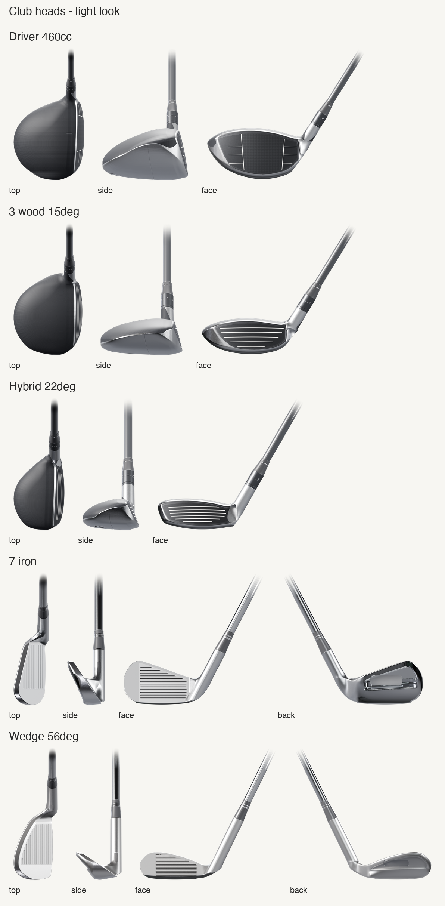

# Club heads

Five generic golf club heads, modelled from scratch as parametric signed-distance models and rendered headless in Blender:

| Club | Loft | Lie | Heel–toe × face–back | Face height |
|---|---|---|---|---|
| Driver, 460 cc | 10.5° | 58° | 120 × 113 mm | 54 mm |
| 3 wood | 15° | 58.5° | 111 × 87 mm | 36 mm |
| Hybrid | 22° | 60° | 105 × 70 mm | 35 mm |
| 7 iron, players' cavity back | 34° | 62.5° | | 45 mm |
| Wedge | 56° | 64° | | 32 mm at the toe |

All face heights are vertical.

The heads are proportioned from measured photographs of current retail heads, and the photographs are not included. The repository holds no third-party geometry, artwork, names or logos. The sleeve index marks are generic numbers.

## Using the renders

Each render is in `out/<club>/<club>_<view>_<look>.png`. It is 2048 px on the long side with a transparent background, and a `…@512.png` copy sits beside it.

- **Views:** `top`, `side`, `face`, plus `back` for the iron and the wedge. A right-handed golfer is at address with the target to the right.
- **Looks:**
  - `light` is for light backgrounds.
  - `dark` is for dark backgrounds. Every part of the silhouette keeps ΔL* ≥ 12 against #15171A.
  - `line-black` and `line-white` are an even 2.1 px stroke, for print and diagrams.
- **Not included:** shadows, a ball, a grip or shaft labels. The shaft stub fades out in the light and dark looks, and ends square in the line looks.

### Anchor JSON

Each club and view has an anchor file, `out/<club>/<club>_<view>.json`. It gives you what you need to place a render, rotate it and annotate it without measuring the image.

- **Pixel coordinates** have the origin at the top left, with y down.
- **World coordinates** are in mm: +X toward the target, +Y toward the golfer (the heel), +Z up, and the ground at z = 0.

| Field | Meaning |
|---|---|
| `mm_per_px`, `image{width,height}` | Scale and image size. |
| `world_to_px` | A 2×4 matrix: px = M·[x, y, z, 1]. |
| `loft_deg`, `lie_deg`, `offset_mm` | The head as modelled. |
| `pivot` | The rotation centre: the face centre in `top`, the leading-edge midpoint in `side`. |
| `face_centre` | The nominal impact point. |
| `leading_edge{heel,toe,mid}` | `mid` is the bottom edge of the face below the face centre. |
| `face_plane` | Two points ±30 mm either side of the face centre. They run up the face in `side` and heel to toe in the other views. |
| `face_normal`, `face_normal_toward_viewer` | A unit vector in image space. |
| `shaft_axis` | Where the shaft axis meets the ground, and the end of the shaft stub. |
| `ground_y`, `sole_contact` | The ground line (null in `top`) and the lowest sole point. |
| `head_bbox`, `body_bbox`, `alpha_bbox` | The head including the hosel, the head without the hosel, and the rendered pixels. |
| `face_frame` (face and back views) | px = origin + x_mm·`x_px_per_mm` + y_mm·`y_px_per_mm`, where +x is toward the toe and +y is up the face plane. The camera is horizontal, so +y is foreshortened by cos(loft), and the shaft shows the true lie. |

To show face angle or path, rotate the `top` render about `pivot`. To show dynamic loft, rotate the `side` render about `pivot`. To place a strike on the face, use `face_frame` in the `face` view.

`out/anchors_check.png` draws every anchor over every view.

## Rebuilding

You need:
- Blender 5.2 or later. Set `BLENDER` if it isn't at `/Applications/Blender.app/Contents/MacOS/Blender`.
- `python3` with numpy and Pillow, for the sheets and checks.

| Command | What it does |
|---|---|
| `src/make_all.sh` | Rebuilds everything from scratch. It wipes `out/` and `work/`, and takes about 25 min on an M4 with CPU Cycles. |
| `src/make_club.sh iron` | Rebuilds one club: geometry, then one Blender process per view and look. |
| `src/iter.sh iron 0.3 light,line` | A quick look at coarse voxels and 768 px. The peeks go to `$PEEK_DIR`, which defaults to `$TMPDIR`. |
| `python3 src/sheets.py --all` | Makes the contact sheets and the anchors check. |
| `python3 src/sheets.py --check` | Checks the silhouette contrast of the dark look. |
| `src/dark_pv.sh` | Renders dark-look previews for all clubs and runs the contrast check. |
| `src/neck_diag.sh wedge` | Crops the face-to-hosel neck in curvature, zebra and light renders. |

Every Blender run goes through `src/run_blender.sh`. It refuses to start a second Blender, and kills a run at 15 min (`BL_MAX_SEC`) or 5 GB (`BL_MAX_MB`).

### How a head is built

`src/clubs.py` holds one numpy signed-distance model per head, set by the `CLUBS` dict.
1. The model is sampled on a voxel grid of 0.15–0.20 mm.
2. The OpenVDB module that ships with Blender turns it into a mesh of 1–2 M quads per head.
3. Each vertex gets attributes that drive the shaders.

`src/render.py` renders orthographic views and writes the anchors. `src/sheets.py` makes the `line-white` look, the `@512` copies and the sheets.

The modelled detail:
- **Woods:**
  - Faces: a flush face with bulge and roll; a face insert with an engraved seam; score lines (painted on the 3 wood and hybrid).
  - Crown: a paint line between the crown and the skirt; matte carbon twill on the crown.
  - Sole: satin titanium; a sole-plate seam; torx weight screws in ports.
  - Hosel: an exact cone set behind the face with a concave fillet into the crown; an adjustable sleeve with index marks; a banded ferrule; a graphite shaft stub.
- **Irons:**
  - Face: cut grooves (12 on the 7 iron, 18 on the wedge); a blasted scoring area (milled arcs on the wedge).
  - Sole and back: a faceted sole with bevels and bounce; heel and toe relief on the wedge; a polished cavity with a rim and a blank badge recess.
  - Hosel: an exact cone with a concave cove into the face; a flush, banded ferrule; a steel shaft stub.

**Parameters** are in the `CLUBS` dict, with lengths in mm and heights vertical.
- **Woods:**
  - outline and section profiles: `width`, `depth`, `plan_mm` (the traced outline), `sil_face` (the face-view silhouette), `crown_u`/`crown_h`, `sole_u`/`sole_h`, `crown_lat`/`sole_lat`, `rtx`/`rtz`/`rbx`/`rbz`;
  - face: `fc`, `bulge`/`roll`, `insert`, `score`;
  - hosel and shaft: `hosel`, `sleeve`, `ferrule`, `shaft`;
  - sole: `screws`, `seam`, `slot`, `rails`.
- **Irons:**
  - outline and neck: `outline` (the face-view polygon), `neck`/`cove`, `heel_back` (keeps the top line thin at the heel:
    the back of the blade sweeps into the hosel's back edge, by hand with `diag` on the 7 iron, or derived from a heading
    and bend radius with `rule` on the wedge);
  - sections: `t_face`, `w_top`, `sole_w`, `back_ts`/`back_m`/`flange`;
  - details: `cavity`, `sole`, `grooves`, `blast`, `hosel`, `offset`, `badge`.
- **Both:** `loft`, `lie`, `h` (the voxel size).

To check surface quality, use `--looks zebra` or `--looks curv` with `render.py`.

### Lighting

- **Environment:** the reflections and fill come from `ref/studio_small_08_2k.hdr`, *Studio Small 08* by Sergej Majboroda (Poly Haven, CC0 1.0). See `ref/SOURCE.txt`.
- **Area lights:** procedural area lights are placed per view in camera space. Lofts of 30° and up get a lower top rim and a dim face card.
- **Dark look:** a low kicker and lower and mid rims (`DARK_SEPARATION` in `render.py`) separate the silhouette from a dark background.

### Line look

The line look is not made with Freestyle, which gives stair-stepped strokes on voxel meshes.
1. Each view is rendered at 3× as a flat ID pass, carrying the region label, groove ink and depth.
2. The script marks label boundaries and depth steps, then adds centre lines for the grooves and score lines.
3. Everything is dilated to one even stroke and box-downsampled.

### Limits

- **Edges:** the voxel mesh rounds edges at about 0.2 mm, so the driver's finest score lines are shader-only.
- **Boundaries:** the paint line and the material boundaries follow per-vertex attributes. They are smooth, but they aren't exact CAD curves.
- **Meshes:** `.blend` files are written to `work/` and not committed, because each head is 1–2 M faces. Run `make_club.sh` to get them.
- **Render time** (M4, CPU Cycles, 128 spp with adaptive sampling and OIDN):
  - 40–110 s per light or dark image, and about 5 s per line pair;
  - peak Blender memory is about 3.6 GB;
  - each view and look renders in its own process, because Metal Cycles and full-quality OIDN both went above 5 GB.
